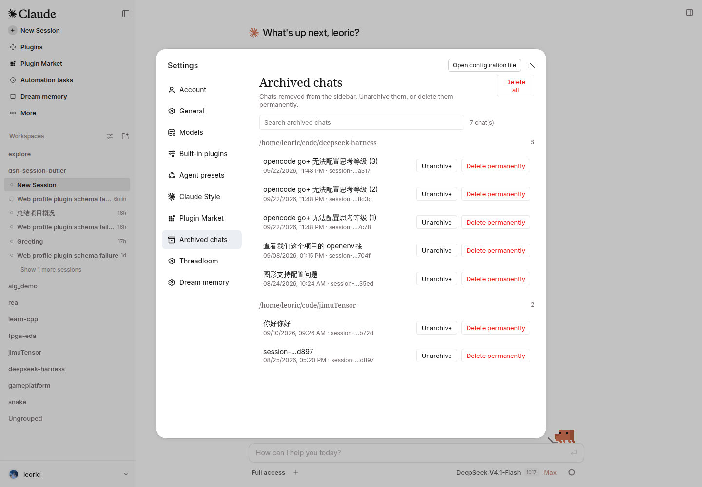

# 会话管家 · dsh-session-butler

[](https://www.npmjs.com/package/dsh-session-butler)
[](https://github.com/leoriczhao/dsh-session-butler/actions/workflows/ci.yml)
[](LICENSE)

DeepSeek Harness 的会话管理插件：给已归档的会话一个列表，给会话行一个真正的删除。

DSH 已经能改名、置顶、归档、分叉；归档之后没有地方查看，也没有删除入口。会话管家补上这两块：设置里多一个「已归档的聊天」分区，会话行多一项「删除会话」。



## 你会得到

- **已归档的聊天**（设置 → 已归档的聊天）：按项目分组、搜索、取消归档、永久删除、全部删除。
- **删除会话**（会话行 `...` 菜单）：确认一次就删掉，没有回收站第二步。
- **级联删除子代理**：删主会话时可选带走它的子代理会话；普通 fork 不受影响。
- **给模型用的工具**：列出、查看、新建、分叉会话（`session_butler_list` / `detail` / `new` / `fork`），破坏性操作不开放给模型。

## 安装

在 DSH 的 **插件** 页搜索 `dsh-session-butler` 安装，或者：

```sh
dsh plugin --profile web add dsh-session-butler
```

装完重启一次 `dsh web`。Host 半的新代码只有重启后才生效，Client 半刷新页面即可。

从本仓库源码安装（需要先 `pnpm install && pnpm run build`）：

```sh
dsh plugin --profile web add /path/to/dsh-session-butler
```

## 使用

| 入口 | 做什么 |
|---|---|
| 设置 → **已归档的聊天** | 看已归档会话，按项目分组、搜索；取消归档；永久删除；全部删除 |
| 设置 → **会话管家** | 插件配置，改完立即生效 |
| 会话行 `...` → **删除会话** | 确认后永久删除该会话 |

0.3.0 已移除 `/session-butler` 命令，不提供 CLI 回收站恢复或清理入口。取消归档只恢复侧栏显示，不能恢复已删除会话。

## 删除是怎么做的

确认之后直接删，不留回收站页面。删除前会检查这个会话还能不能安全删：

- **没被 DSH 加载的会话**：立即删除，目录和日志一起清掉。
- **仍被 DSH 加载的会话**：**拒绝删除**，并说明原因——还在跑就先停掉；只是被加载就安全重启 DSH 后再试，重启后不要重新打开它。插件不会为了删除去停任务、改归档状态或动文件。
- **其他进程正在写**：拒绝，提示先关掉占用它的进程。

级联删除只沿 subagent 走，普通 fork 及其子会话不会被带走；确认框里会写明这次会删几个子代理会话。

Host 内部仍先同盘移入回收站，再立即清除；清除失败时可能留下条目供人工检查，这不构成用户可用的恢复功能。

## 配置

设置 → 会话管家，四项：

| 字段 | 默认 | 说明 |
|---|---|---|
| `trashRetentionDays` | `30` | 内部回收站条目的过期标记天数，`0` 表示不标记过期；不会自动清理，也不延迟 GUI 删除 |
| `liveSettleTimeoutMs` | `3000` | 等待宿主释放会话的毫秒上限，超时即拒绝 |
| `cascadeSubagents` | `true` | 删除时是否连带子代理会话 |
| `inlineMenuEnabled` | `true` | 是否在会话行菜单里显示「删除会话」 |

配置文件里还保留 `permanentDelete`（默认 `disabled`）以兼容已有 profile patch；它只约束 Host 服务显式调用的 `purge()`，需设为 `confirm` 并匹配完整 session id。GUI 删除以确认对话框授权，不受该配置限制。

## 兼容性

需要 DSH `>=0.2.1-rc.2 <0.3.0-0`（由顶层 `engines.dsh` 判定）。headless / ACP 组合下按可用服务降级：有 `tools` 才注册只读 `list`/`detail`；`new`/`fork` 还分别要求 `sessionController.create`/`fork`。没有 Web 服务时不挂 HTTP bridge，也不提供设置页或删除入口。

## 开发

```sh
pnpm install
pnpm run verify       # typecheck + build + 67 个单元测试 + npm pack 契约
pnpm run test:e2e     # 真实 dsh web 组合 + Playwright 浏览器
```

产物两半：`lib/index.js`（Host，`apply(ctx, config)`）和 `lib/client.js`（Web Client，由宿主模块加载器注入）。

发布前更新 `package.json` 与更新记录，再推送对应的新 tag，由 GitHub Actions 用 npm trusted publishing 发布并附 provenance（已发布的版本和 tag 不重复使用）：

```sh
release_version=$(node -p "require('./package.json').version")
git tag "v$release_version" && git push origin "v$release_version"
```

## 文档

- [使用说明](https://github.com/leoriczhao/dsh-session-butler/blob/main/docs/usage.md)：每个入口的细节和安全边界
- [架构](https://github.com/leoriczhao/dsh-session-butler/blob/main/docs/architecture.md)：Host/Client 两半、删除管线、HTTP 桥
- [决策记录](https://github.com/leoriczhao/dsh-session-butler/blob/main/docs/decisions.md)：为什么是现在这个形态
- [测试](https://github.com/leoriczhao/dsh-session-butler/blob/main/docs/testing.md)：单元测试与两层真实环境验证

## 许可证

MIT
