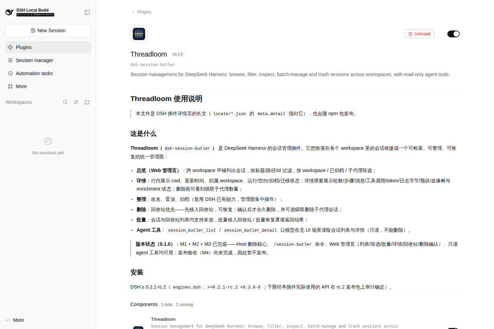
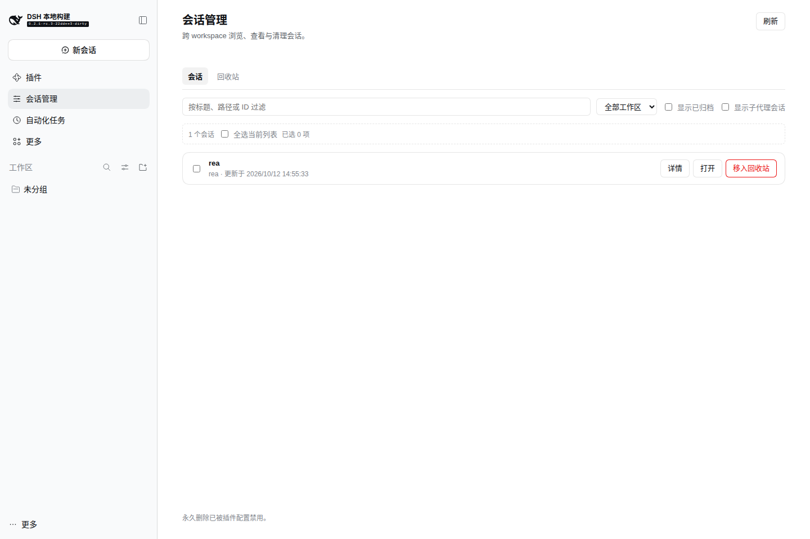
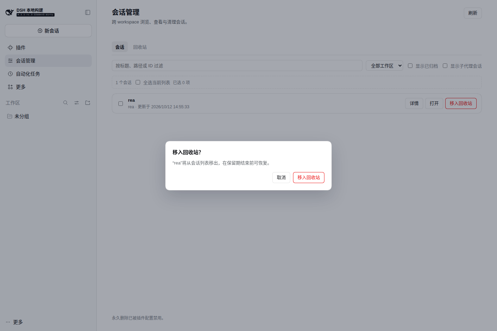
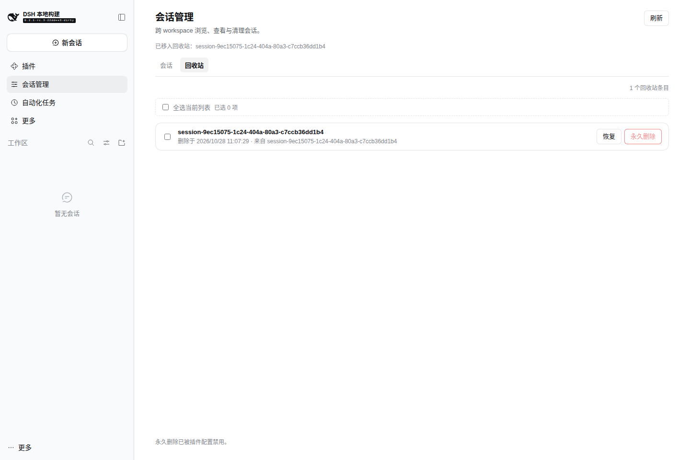
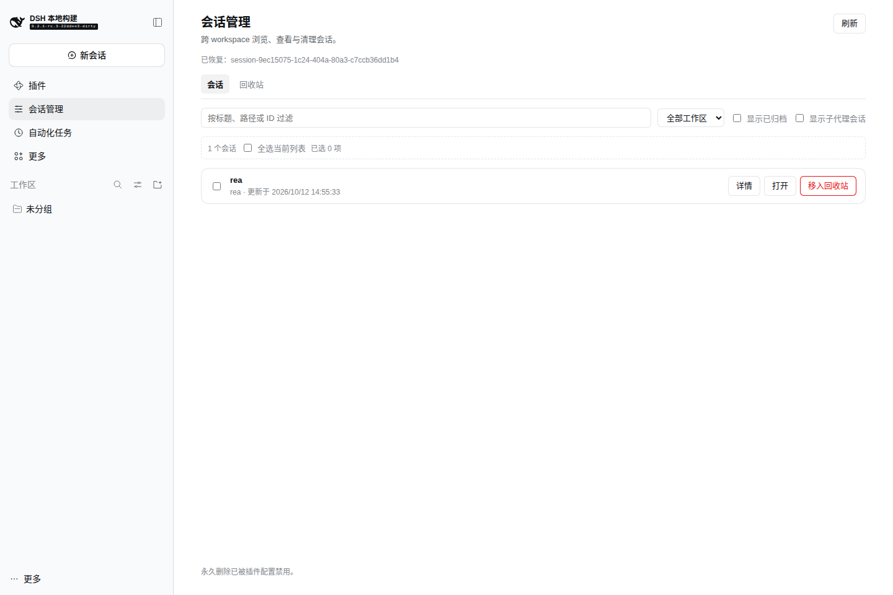

# 发布流程（Runbook）

> 目标：把 `dsh-session-butler`（Threadloom）作为一个**可安装、可发现、可更新**的 DSH npm 插件包发布。
> 契约细节（字段、校验链路、25 条坑位）见 [`dsh-packaging-contract.md`](./dsh-packaging-contract.md)；本文只记录本项目要执行的命令与顺序。
> 当前 DSH 运行时基线：`0.2.1-rc.2` 起（`engines.dsh: ">=0.2.1-rc.2 <0.3.0-0"`；下限经 API 审计，见 `research/dsh-session-management-v2.md` §5.4。npm `latest` 当前是 rc.2）。

## 0. 前置

- Node ≥ 24.9，pnpm 11.x（仓库内 `packageManager`/CI 已固定），npm 账号已登录（`npm whoami`）。
- **不要在 DSH profile 目录里手工 `pnpm add` / 改 `package.json`**：安装统一走 `dsh plugin` 或 `plugin_manager`。
- 发布前确认工作区干净：`git status`，版本号与 `CHANGELOG.md` 一致。
- 发布前补齐 `package.json` 元数据：`author`（当前为 `Threadloom contributors`）、`repository`/`homepage`/`bugs`（当前省略，发布前按实际 GitHub 仓库补上）。这些字段不参与运行，但影响 npm 页面、市场索引与"从仓库详情回退"的插件详情。
- README 里指向 `docs/architecture.md` 等**未随包发布**文件的链接，发布前要么改成 GitHub 绝对链接，要么把对应文档加入 `files`（npm 页面只展示包内文件；`meta.detail` 指向的 `docs/usage.md` 已随包发布）。
- 发布前复核 `engines.dsh` 下限：npm `latest` 目前是 `0.2.1-rc.2`（不是 rc.3）。按实际用到的 API（rename/pin/archive/fork/create 等）在 rc.2 上验证；兼容则降到 `>=0.2.1-rc.2`，否则保留 rc.3 下限并在 README 说明。

## 阶段 A：本地构建与自查

```bash
pnpm install --frozen-lockfile
pnpm run verify          # typecheck + clean build + tests + validate:package
```

`verify` 会做：

1. Host/Client 两套 tsconfig 类型检查；
2. `lib/index.js`（ESM）、`lib/types/**`、`lib/client.js`（classic-script 工厂）构建；
3. 产物冒烟：Host 模块可 import、Client bundle 可注册工厂且不依赖模块表；
4. manifest 契约 + `npm pack --dry-run` 文件闭环 + `engines.dsh` 与本地 DSH 版本匹配。

人工再确认一次 client 产物头尾：

```bash
head -c 200 lib/client.js
tail -c 120 lib/client.js
# 期望开头 window.__ModuleLoader__.load({ id: "dsh-session-butler", factory: (require) => {
# 期望结尾 return module.exports; } });
grep -c 'require("react")' lib/client.js   # MVP 前应为 0；有 UI 后应 > 0 且未内联 React
```

## 阶段 B：打包产物校验（最关键）

```bash
npm pack --dry-run            # 或 npm pack 生成 tgz
npm pack                      # 生成 dsh-session-butler-<version>.tgz
tar -tzf dsh-session-butler-*.tgz | sort
```

必须包含：`package.json`、`lib/index.js`、`lib/client.js`、`lib/types/index.d.ts`、`cordis.patch.yml`、`locale/en.json`、`locale/zh.json`、`icon.svg`、`README.md`、`CHANGELOG.md`、`docs/usage.md`、`LICENSE`。
不得包含：`src/`、`tests/`、`scripts/`、`tsconfig*`、`.github/`、`node_modules/`。

在**干净临时目录**验证安装形态下 exports 可解析。Host 入口直接 import
`@deepseek-ai/schemastery`/`@deepseek-ai/cordis`，它们是 optional peer，不会被
`npm install <tgz>` 自动带入；真实 DSH profile 从 `$DSH_HOME/profiles/node_modules`
解析这两个包，干净目录验证时需显式安装同版本 peer：

```bash
tmp=$(mktemp -d); cd "$tmp"
npm init -y >/dev/null
npm install /path/to/dsh-session-butler-<version>.tgz \
  @deepseek-ai/cordis@4.0.5 @deepseek-ai/schemastery@3.18.5
node -e "const p=require('dsh-session-butler/package.json'); console.log(p.name,p.version,p.engines.dsh)"
node --input-type=module -e "await import('dsh-session-butler')"   # Host ESM: exports/apply/inject
# client 是 classic script，不能直接 require：在浏览器沙箱里确认工厂注册。
node --input-type=module -e "
import fs from 'node:fs'; import vm from 'node:vm';
const code = fs.readFileSync('node_modules/dsh-session-butler/lib/client.js', 'utf8');
let registration; vm.runInNewContext(code, { window: { __ModuleLoader__: { load(v) { registration = v } } }, console });
console.log(registration.id, typeof registration.factory);
"   # 期望: dsh-session-butler function
```

2026-10-28 实测：`npm pack` 生成的 `dsh-session-butler-0.1.0.tgz` 安装到空目录后，
`package.json` 的 `name/version/engines.dsh` 与 exports 均可解析；Host 导入返回
`apply/inject/Config/SessionButlerService` 等导出；client bundle 沙箱注册返回
`dsh-session-butler function`。

## 阶段 C：本地 link 安装验证（发布前必做）

新建一次性 profile，避免污染日常 profile：

```bash
dsh plugin --profile tl-dev add /home/leoric/code/dsh-session-butler   # 绝对路径 → linked
dsh --profile tl-dev --dump-config | grep -A3 'session-butler'
```

启动 Web 端（`dsh --profile tl-dev`，或按桌面端流程）后检查：

- Host 无 `FAILED` fiber；插件行 title/description/icon 正确（中英文各看一次）；
- 浏览器控制台无 `client bundle not found` / `missed the module table` / `loaded without registering`；
- 插件详情页显示 `docs/usage.md`（`meta.detail`）；
- MVP 功能冒烟：列表、筛选、详情、trash → restore（隔离 `DSH_HOME`，见下）、运行中拒绝、子代理级联计数；`purge` 需显式开启配置后再测；
- 卸载回归：`dsh plugin --profile tl-dev remove dsh-session-butler`，确认行消失、无残留；删除临时 profile 与隔离 home。

> 注意：同一个包不能同时以 link 和 registry 两种形态被两个 loader source 解析，否则 Client 组合报 `resolves from multiple active Loader sources`。测试前确认临时 profile 里没有旧安装。

**写入类冒烟必须隔离 `DSH_HOME`。** profile 只隔离插件配置/依赖，真实会话仍存放在
`$DSH_HOME/sessions`；在默认 home 里点击“移入回收站/恢复”会改到日常会话。发布前用
一次性 home 跑完整闭环：

```bash
export DSH_HOME=/tmp/threadloom-e2e-home
rm -rf "$DSH_HOME" && mkdir -p "$DSH_HOME"
dsh --profile tl-iso --from-default-profile web --dump-config
dsh plugin --profile tl-iso add /home/leoric/code/dsh-session-butler
dsh --profile tl-iso --no-open --port 3109
# 隔离 home 没有历史会话。为验证写路径，可把一条已完成的 session.v4.jsonl.zstd
# 复制到 "$DSH_HOME/sessions/--<normalized-cwd>--/<encoded-id>/"，再重启服务；
# 或在隔离 home 里新建一个测试会话。随后只在 3109 端口操作测试会话。
```

### 阶段 C 实测记录（2026-10-28）

环境：DSH `0.2.1-rc.3-22ddee3`，隔离 `DSH_HOME=/tmp/tl-m4/home`，profile
`tl-iso`，插件以绝对路径 link 安装，端口 3109，Playwright Chromium 无头。

| 检查 | 结果 |
|---|---|
| host / client 激活 | 页面无 `dsh-session-butler: failed`，无 `client bundle not found` / 模块表错误 |
| 列表/筛选/计数 | 1 个会话正确渲染；标题、workspace、更新时间、行内按钮正常 |
| 详情弹窗 | ID/cwd/创建时间/preset/状态/轮数/步骤/消息/工具/token/日志大小全部渲染 |
| 行删除确认 | 文案与保留期说明正确；取消不写入 |
| 批量确认 | 选中 1 项后批量栏出现，确认框显示“将 1 个会话移入回收站？”；取消不写入 |
| 隔离写入闭环 | 确认后：会话列表 `0`、回收站 `1`；恢复后：回收站 `0`、会话列表 `1` |
| 永久删除 | 按钮按默认配置禁用并给出原因提示 |
| 控制台 | 无 console error / pageerror |

插件页（`meta.detail`、图标、名称/版本/id）也在同一隔离 profile 实测：详情页完整
渲染 `docs/usage.md`，组件状态 `1 total · 1 running`。



页面证据截图（隔离 home，单个测试会话）：






首轮真实浏览器启动曾暴露 M2 客户端注册 bug（`slot "sidebar.panellist" is not
declared`），修复见 `CHANGELOG.md` 的 “real-browser activation” 段；修复后上述检查
全部通过。

## 阶段 D：发布

```bash
npm publish          # prepack 自动 typecheck + build；scoped 包需 --access public（本项目 unscoped）
```

发布后核对 registry 元数据（**`dsh` 字段必须在 npm 上可见**，更新检查依赖它）：

```bash
npm view dsh-session-butler@<version> name version engines peerDependencies dsh license repository
git tag v<version> && git push origin v<version>
```

## 阶段 E：从 registry 全新安装验证

```bash
dsh plugin --profile tl-fresh add dsh-session-butler@<version>
cat ~/.dsh/profiles/tl-fresh/package.json      # dependencies + dsh.profile.bundles（bundle 追加在末尾）
dsh --profile tl-fresh --dump-config | grep -A3 'session-butler'
dsh --profile tl-fresh                          # 启动并复跑阶段 C 的 UI/功能检查
```

再验证一次更新路径（可选但推荐）：安装上一版本 → Web 插件页 Update 或 `plugin_manager updateBundle` → 确认 `listVersions` 能列出、精确保存版本；无 HMR 的 profile 需重启。

## 发布后

- 在仓库 Release 附上 `npm pack` 的 tgz（可选；git 安装场景需要 `prepare`，本项目未启用，推荐直接用 registry）。
- 插件市场索引（dshmarket / awesome-dsh-plugin 等）：按 `docs/dsh-packaging-contract.md` §9 的 format 1 字段提交；至少需要 `name`、`version`（安装 spec）、`dsh` 元数据与 README/详情。
- 若发现发布事故：72 小时内可 `npm unpublish`，更推荐 `npm deprecate dsh-session-butler@<version> "reason"` 并发布修复版本。

## 本项目的发布门禁

发布 `0.1.0` 前必须满足 [`decisions.md`](./decisions.md) 的「发布门禁」清单（MVP 功能、边界测试、link/registry 双验证、展示资源），**基础包阶段的 `0.1.0` 不发布**。
