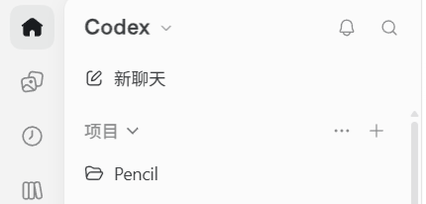
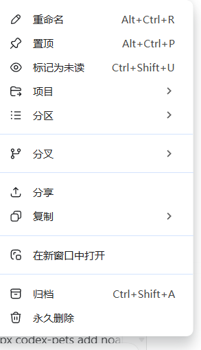
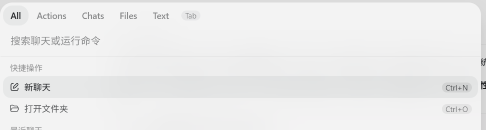

# Codex 桌面端（ChatGPT desktop）会话管理 UI 实机审计

> 目的：用户明确要求"参考 ChatGPT 里面 Codex 部分的会话管理"。既有 `research/codex-session-management.md` 覆盖的是 **Codex CLI / TUI / app-server** 三条通路；本文补上 **ChatGPT 桌面 App 内 Codex 部分的人类 UI 实机证据**，作为 D3 设计的一手输入。
>
> 方法与边界：在用户本人的 Windows 11 桌面上运行 ChatGPT 桌面应用（Microsoft Store 包 `OpenAI.Codex 26.1023.6123.0`，进程名 `ChatGPT`，窗口标题 `ChatGPT`，侧栏产品位显示 `Codex`）。经 WSL2 interop 调用 PowerShell：EnumWindows + 截图 + 鼠标键盘输入。**只做只读观察**（hover、右键菜单、搜索、开关侧栏/浏览器标签、打开会话）；**未执行归档、删除、置顶、重命名等任何写操作**。截图已脱敏裁剪到 `research/assets/codex-app/`。
>
> 观察时间：2026-10-28 17:55–18:05（Asia/Shanghai）。用户账号与工作区为真实数据，本文只记录控件与交互，不采集私人内容。

> ⚠️ **补遗（2026-10-29）**：本文 §1 把 Settings 列为「未观察」，但没有把它当作阻塞缺口——用户随后指出归档会话在 **设置 → 已归档的聊天**（`docs/evidence/chatgpt-archived-chats-settings.png`），并且产品里没有「会话库」页面。本文 §0.12 的「Library 核心」结论已被 `docs/decisions.md` D-029 取代；调研缺口与修正流程见 `research/2026-10-29-research-corrections.md`。

---

## 0. TL;DR（12 条）

1. Codex 的会话管理不是"管理页"，而是**常驻侧栏 + 行内动作 + 右键动作面 + 全局命令面板**四件套；没有"会话管理"独立页面。
2. 侧栏信息架构：顶部产品切换位 `Codex ⌄` + 通知 + 搜索；`新聊天`；`项目`（Projects）；`最近`（Recent）；底部账号与 onboarding 进度。
3. 会话行 hover 只出现两个动作：**置顶聊天**、**归档聊天**（tooltip 实测）；并弹出**悬浮预览卡**（标题 / 相对时间 / 所属项目或文件夹）。
4. 删除**不在** hover 动作里。完整动作面在**右键菜单**：重命名、置顶、标记为未读、项目 ▸、分区 ▸、分支 ▸、分享、复制 ▸、在新窗口中打开、归档（Ctrl+Shift+A）、**永久删除**。
5. 因此删除是**二级、不可逆、藏在右键末尾**的守门动作；归档才是行内主生命周期动作。UI 中**没有回收站**视图。
6. 搜索 = **全局命令面板**：`All / Actions / Chats / Files / Text / Tab` 六个 tab，"搜索聊天或运行命令"；快捷操作（新聊天 Ctrl+N、打开文件夹 Ctrl+O）；最近聊天带项目标签；文件搜索匹配工作区文件路径与日期；`Alt+1` 直达首条命中。
7. Codex 会话按**项目/文件夹**组织；同一会话既出现在"项目"下（缩进），也出现在"最近"里（混合排序）。hover 卡会显示所属文件夹。
8. 会话视图头部：标题 + `…` 菜单 + 分屏 + 右侧栏；右侧栏是**"输出内容 / 来源"**面板（artifact/source，如 `codex-clipboard-f0f4a72e…`、`网页搜索`、`查看全部`）。
9. 消息区细节：折叠的"上 32 条消息"、轮次"用时 4m 11s"、diff 卡片（`已编辑 restart-framewiew.ps1 +31 -0`，带撤销/查看变更）、composer 的 `@ 请求批准` 与模型选择器。
10. 应用层 chrome 与 Codex 文档一致：**原生菜单栏**（文件/编辑/视图/帮助）、**内嵌浏览器标签页**（Ctrl+Shift+B，含"侧边聊天 Ctrl+Alt+S / 终端"工具）、**侧栏开关 Ctrl+Shift+S**、左侧 10 个 app 级图标轨。
11. Codex 的会话管理核心价值排序（从 UI 出现频次与层级推断）：**找得到（搜索/最近/项目）→ 看得懂（preview/详情/来源）→ 接得回（继续/分叉）→ 收得拢（置顶/归档）→ 删得掉（永久删除，守门）**。
12. 对 Threadloom D3 的直接结论：**删除/回收站不应做"下一版核心"**，应降级为"清理"模块；核心是 **Library（检索+分组）+ Detail（预览+血缘+来源）+ Organize（置顶/归档/重命名/标签）+ Resume/Fork（续聊+分叉）**。理由见 §9。

---

## 1. 观察环境

| 项 | 值 |
|---|---|
| 应用 | ChatGPT 桌面端（Store 包 `OpenAI.Codex`，版本 `26.1023.6123.0_x64__2p2nqsd0c76g0`） |
| 进程 | `ChatGPT.exe`（Electron/Chromium 类，窗口类 `Chrome_WidgetWin_1`），另有 `codex.exe`、`codex-windows-sandbox-service` |
| 平台 | Windows 11（WSL2 Ubuntu-24.04 内的 DSH 宿主，通过 interop 控制同一台 Windows） |
| 显示 | 2560×1440，应用最大化后窗口 2560×1380 |
| 观察面 | Codex 产品的侧栏、会话行、右键菜单、命令面板、会话视图、应用 chrome |
| 未观察 | Settings 入口（Ctrl+, 无响应；账号菜单点击未打开）、归档/删除确认弹窗、`项目/分区/分支` 子菜单内容、左轨图标 tooltip、`Codex ⌄` 切换菜单 |

**局限**：用户当时在同时使用电脑，后续交互停止以免干扰；部分控件（Settings、子菜单）未验证，已在 §10 标注为待补。截图未包含用户私人正文，仅保留控件与菜单区域。

---

## 2. 侧栏信息架构（实机）

\`\`\`
┌─ 应用左轨（10 个图标，未命名；当前高亮 Home）
│  ┌─ 侧栏 ────────────────────────────────┐
│  │ Codex ⌄        🔔  🔍                 │
│  │ ✎ 新聊天                              │
│  │ 项目 ⌄                       ⋯   +    │
│  │   📁 Pencil                           │
│  │      · chat A（缩进）                  │
│  │      · chat B …                        │
│  │ 最近                                  │
│  │   · chat E                            │
│  │   · chat F …                          │
│  │                                       │
│  │ （底部）(LE) 开始使用 2/4              │
│  └───────────────────────────────────────┘
└──────────────────────────────────────────┘
\`\`\`

- **产品位**：`Codex ⌄`——新 ChatGPT 桌面端把 ChatGPT / Codex /（Work 等）收进一个应用，这里是 Codex 分区的入口/切换位；本次未展开其菜单。
- **`新聊天`**：全局新建（快捷键见 §4 的 Ctrl+N）。
- **`项目`**：项目列表；hover 时区域标题右侧出现 `⋯`（项目菜单）与 `+`（新建项目）。
- **`项目行`**：hover 时右侧出现 `⋯`（项目菜单）与"新建会话"图标（在该项目内开新 chat）。
- **`最近`**：跨项目/无项目的最近会话混合列表，按最近活动排序；同一会话可在项目中与"最近"里重复出现。
- **底部**：账号头像 `LE` + onboarding 进度 `开始使用 2/4`。

---

## 3. 会话行的三种交互层

### 3.1 Hover：两个动作 + 预览卡

hover 会话行时，行尾出现两个图标（实测 tooltip）：

| 图标 | Tooltip | 语义 |
|---|---|---|
| 📌 | **置顶聊天** | pin / unpin |
| 🗄 | **归档聊天** | archive（移出活动列表，可恢复） |

同时弹出**悬浮预览卡**：

- 标题；右侧相对时间（实测 `1个月前`）；
- 下方一行：📁 + 项目/文件夹名（实测 `w`，即该会话所属文件夹/项目）；
- 卡片是只读预览，不带动作按钮。

**没有**行内"删除"、没有行内"重命名"——最常用的两个动作是 pin/archive。

### 3.2 右键：完整动作面（实测）

| 动作 | 快捷键（菜单实物） | 子菜单 | 备注 |
|---|---|---|---|
| 重命名 | `Alt+Ctrl+R` | — | 打开重命名输入 |
| 置顶 | `Alt+Ctrl+P` | — | 同 hover 📌 |
| 标记为未读 | `Ctrl+Shift+U` | — | DSH 没有的轻量状态 |
| 项目 | — | ▸ | 把会话挂到项目/移出项目 |
| 分区 | — | ▸ | 分区/分组（本次未展开） |
| 分支 | — | ▸ | 分支会话（本次未展开；与 Codex CLI 的 fork 一致） |
| 分享 | — | — | 分享 |
| 复制 | — | ▸ | 复制（内容/链接等子项） |
| 在新窗口中打开 | — | — | 独立窗口 |
| 归档 | `Ctrl+Shift+A` | — | 行内动作的菜单版 |
| **永久删除** | —（无快捷键） | — | 菜单最底部；**未执行**，确认弹窗未观察 |

要点：
- **动作分级清楚**：常规组织动作在上，危险动作（归档/删除）在分隔线以下的最底部；删除没有快捷键。
- 归档有快捷键、删除没有——**鼓励归档、抑制误删**的设计。
- 菜单里出现"分支"，说明桌面端**把分叉当作会话的一等动作**，与 CLI `/fork`、`thread/fork` 对齐。

### 3.3 单击：打开会话（续聊）

单击行打开该会话；会话视图头部有 `…`（更多）、分屏、右侧栏开关。本次点击 `…` 未弹出菜单（坐标/命中问题），列为待补。

---

## 4. 全局搜索/命令面板（实测）

点击侧栏搜索图标打开命令面板（与 ChatGPT 的 Ctrl+K 概念一致）：

- Tabs：`All / Actions / Chats / Files / Text / Tab`。
- 输入框占位：**"搜索聊天或运行命令"**（一个面板同时检索会话、文件、文本、浏览器标签与执行动作）。
- 分组：
  - `快捷操作`：`新聊天`（Ctrl+N）、`打开文件夹`（Ctrl+O）；
  - `最近聊天`：会话行 + 右侧项目标签（实测 `Pencil`）；
  - `文件`：工作区文件路径 + 日期（实测匹配 `nvidia.rst`、`nvidia-diagnostics`、`app-client-before.log`、`restart-framewiew.ps1` 等）；
  - `Text` / `Tab`：会话正文与浏览器标签检索（tab 未逐项实测，但 tab 存在）。
- 输入命中后首条带 `Alt+1` 快捷键；`Esc` 关闭。

**设计含义**：Codex 把"搜索"做成**命令面板**而不是筛选框——一个入口同时解决"找会话、找文件、找正文、执行动作"，并支持键盘直达。这是 D3 控制台最值得抄的交互，而不是"再加一个搜索框"。

---

## 5. 项目 / 分组

- `项目` 区域标题 hover：`⋯`（项目菜单）、`+`（新建项目）。
- 项目行 hover：`⋯`（项目菜单）、"新建会话"（在项目内新建）。
- 项目内会话缩进显示；同一会话同时出现在 `最近`。
- hover 预览卡显示会话所属文件夹/项目（实测 `w`）——即**项目归属是会话的一等元数据**。

未验证：项目菜单的具体项（重命名/删除/排序/归档？）、项目与"文件夹"的关系（Codex CLI 的 cwd/project 概念）、"分区"是否等于项目内的自定义分组。

---

## 6. 会话视图（打开后）

实测界面元素：

| 区域 | 内容 |
|---|---|
| 头部 | 会话标题（`排查 NVIDIA App 问题`）、`…`、分屏图标、右侧栏开关 |
| 右栏 | `输出内容` / `来源`：artifact 列表（`codex-clipboard-f0f4a72e…`、`网页搜索`、`查看全部`） |
| 消息区 | 用户气泡、助手 Markdown、diff 卡片（`已编辑 restart-framewiew.ps1 +31 -0`，含"撤销 / 查看变更"） |
| 折叠 | `上 32 条消息 >`（长会话按需展开） |
| 轮次元数据 | `用时 4m 11s >` |
| Composer | 占位 `和 Codex 一起工作`、模型选择器（`6 Astra Max`）、`@ 请求批准`、麦克风、发送 |

含义：Codex 的"会话详情"不是元数据面板，而是**内容 + 产物/来源 + 轮次成本**；会话管理页若要"看得懂"，需要的是这几类信息，而不只是 id/大小/时间。

---

## 7. 应用层 chrome（与会话管理的关系）

- **原生菜单栏**：`文件 / 编辑 / 视图 / 帮助`（桌面端在 Web 技术栈外保留了原生菜单习惯）。
- **内嵌浏览器标签页**：`Ctrl+Shift+B` 开关；新标签页含"工具：侧边聊天 Ctrl+Alt+S、终端"，以及推荐卡片（Camera Meta Review Tool、S3·Cloudflare R2 docs）。说明 Codex 桌面端把**浏览器/终端/侧边聊天**做成常驻工具面。
- **侧栏开关**：`Ctrl+Shift+S` 实测可折叠/展开。
- **左轨 10 个 app 级图标**：本次未逐个 hover 取 tooltip，命名未知（home 高亮；其余含历史/网格/@/⋯/分支类图标）。推测为 ChatGPT 应用级导航（Home、Artifacts、History、Apps、Mentions、More、Worktrees 等），不属于 Codex 会话管理核心，D3 不照搬。

---

## 8. 与 ChatGPT（Chat/Work）会话管理的差异（结合前一轮调研）

| 维度 | ChatGPT Chat / Work | Codex（本文实测） |
|---|---|---|
| 历史入口 | 统一 Recents（Chat+Work） | Codex 独立侧栏；项目+最近 |
| 临时会话 | Temporary chat | 未在 Codex UI 观察到临时会话 |
| 归档 | 有（Archived 可搜索） | 有（行内/右键/快捷键；归档后可恢复） |
| 删除 | 有（确认 + 30 天保留） | **有，但二级右键 + 永久删除**；帮助文档另有"先归档再删/归档页批量删"的路径 |
| 回收站 | 无（删除有保留期） | **无**（永久删除） |
| 置顶 | 有（Pinned 区） | 有（行内 📌 / 菜单） |
| 分组 | Projects | 项目 + 分区（菜单未展开） |
| 搜索 | 搜索 + 筛选 All/Chats/Images/Documents/Projects | 命令面板 All/Actions/Chats/Files/Text/Tab |
| 分叉 | "Branch in new chat"（消息级，2025-09 起） | 菜单"分支"，与 CLI fork 对齐 |
| 其他 | 分享、临时、锁定 | 标记未读、在新窗口打开、分享、复制、右侧来源栏 |

结论：**Codex 比 ChatGPT Chat 更"工作台"化**——项目/文件夹、命令面板、来源/产物、分叉、标记未读，都是为"长期任务与多线程工作"设计的；而删除在两个产品里都是"有但不显眼"的守门动作。

---

## 9. 对 Threadloom D3 的直接结论（含"删除是否核心"的答案）

### 9.1 Codex 证据表明：删除不是核心

1. **层级最低**：不在 hover 的两个主动作里；在右键菜单最底部；无快捷键（归档有 Ctrl+Shift+A）。UI 在"鼓励归档、抑制删除"。
2. **没有回收站**：Codex 桌面 UI 没有 Trash/Recently Deleted 入口；删除即"永久删除"。真正被产品化的是**归档**（可恢复、可浏览）——与 `research/codex-session-management.md` 的 CLI 结论一致（archive ≠ delete）。
3. **核心价值在"找/懂/接/分"**：侧栏（项目+最近）、hover preview、命令面板、分支、续聊、来源栏——这些占据主要 UI 面积与快捷键预算；删除只占一条菜单项。
4. **删除不产生组织价值**：它只是清理端点的守门动作；用户真正高频的是"回到之前的会话/从某点分叉/找到某个任务"。
5. **DSH 的现实约束**：live 会话无法安全删除（`session-running`，无公开 dispose API），回收站本质是"目录移动 + 元数据"，工程复杂度高但用户价值低。把它做成 v2 核心会**用高风险换低价值**。

### 9.2 但删除/清理仍需保留（作为二级模块）

- DSH 会积累测试/失败/一次性会话（本会话自己就留下了 2 个测试会话），**没有官方删除**是真实缺口。
- 正确形态：**归档（复用官方）→ 回收站（插件）→ 永久删除（强确认 + live 拒绝/先停）**；默认 `permanentDelete: disabled`，只在设置页开启。
- D3 把删除放在"清理（Cleanup）"模块，与"库（Library）"同级但默认折叠/低权重；KPI 看"误删=0、回收站可恢复率=100%"，而不是"删除数量"。

### 9.3 Codex UI → DSH/D3 映射表

| Codex 交互 | DSH 现状 | D3 决策 |
|---|---|---|
| 项目 + 最近 | 官方侧栏按 workspace 分组；无项目概念 | 控制台按 workspace 分组 + 搜索/筛选；不硬造"项目"对象（DSH 无），用 workspace + 标签近似 |
| hover 预览卡 | 官方会话行 hover 有摘要（部分版本） | 用插件可用的 `sidebar.session.row.hover` 槽位做轻量增强（大小/轮数/血缘徽标），不重复官方 |
| 置顶/归档行内按钮 | 官方行菜单已有 pin/archive | 不重复；控制台提供批量版与状态筛选 |
| 右键完整菜单 | 官方行菜单已有部分；插件**不能**扩行菜单 | 控制台内提供等价动作（含插件自有：回收站/标签/备注/导出 MD） |
| 命令面板 | DSH composer 有命令（`/`） | 注册 `/session` 命令族；控制台内做 `Ctrl+K` 风格过滤（前端本地实现） |
| 分支 | 官方会话页已有 fork（含 atSeq 选择点） | Agent tool 面已补 `session_butler_fork`（0.1.2）；控制台加"从此会话分叉" |
| 标记未读 | 无 | 可选：插件自有 metadata（不改 DSH 核心），P2 |
| 来源/产物面板 | DSH 会话有工具调用/文件变更视图 | 详情页展示工具/产物摘要（只读），P1 |
| 永久删除（右键底部） | 无删除 | 回收站 → 永久删除（强确认、live 拒绝），默认关闭 |

---

## 10. 待补验证（下一次实机）

1. Settings 入口与"已归档聊天"管理页（Codex 批量删除路径）。
2. 归档确认弹窗文案与行为（归档后去哪、能否恢复、是否停 turn）。
3. 永久删除确认弹窗（是否要求输入/二次确认；是否要求先归档——官方帮助与 UI 的差异）。
4. `项目 / 分区 / 分支 / 复制` 子菜单内容。
5. 左轨 10 个图标的 tooltip 与 `Codex ⌄` 切换菜单。
6. 会话视图头部 `…` 菜单（重命名/归档/删除是否也在其中）。
7. 命令面板 `Text / Tab` 两 tab 的行为与范围。
8. 多选/批量操作（本次未观察到任何 checkbox；Codex 批量删除可能在归档页）。

---

## 11. 证据文件

| 文件 | 内容 |
|---|---|
| `assets/codex-app/sidebar-top.png` | 侧栏顶部：Codex 产品位、搜索、新聊天、项目区、Pencil 项目行 |
| `assets/codex-app/chat-context-menu.png` | 会话右键完整动作菜单（脱敏裁剪，仅菜单） |
| `assets/codex-app/row-action-pin-tooltip.png` | hover "置顶聊天" tooltip |
| `assets/codex-app/row-action-archive-tooltip.png` | hover "归档聊天" tooltip |
| `assets/codex-app/search-palette-top.png` | 命令面板 tabs、占位、快捷操作（裁掉最近聊天正文） |

原始截图（含用户数据，不提交）：Windows 临时目录 `C:\Users\leoric\AppData\Local\Temp\cx-*.png`。

---

## 12. 与既有调研的关系

- `research/codex-session-management.md`：CLI/TUI/app-server 的完整能力矩阵（fork/archive/delete/queue/share…）——本文是它在**桌面 UI** 上的落地观察。
- `research/2026-10-chatgpt-desktop-conversation-management.md`：ChatGPT Chat/Work 的会话管理用例（Recents/Projects/Temporary/Archive/Delete）——本文补上 Codex 分区，二者共同构成"ChatGPT 桌面端会话管理"全貌。
- 本文结论直接喂给 `docs/d3-console-design.md`。
